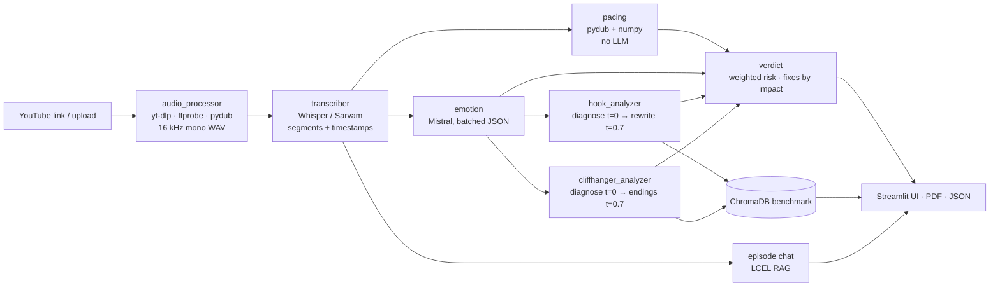

# 🎣 HookLens — Episode Hook & Cliffhanger Analyzer

**Score a micro-drama episode before it ships.** A Kuku TV writer pastes a YouTube link or uploads a
1–3 minute episode (English, Hindi or Hinglish). HookLens transcribes it with timestamps and answers
the four questions that decide retention and revenue:

| Question | HookLens output |
|---|---|
| Will viewers stay past the first 10 seconds? | **Hook score** 0–10 with 5 sub-scores + 3 rewritten openings |
| Will viewers unlock the next episode? | **Cliffhanger score** 0–10 with 5 sub-scores + 3 alternative endings + the best timestamp to cut |
| Where does the episode drag? | **Pacing** (numbers only): words/sec, silence ratio, longest gap, density per 10 s, flagged slow sections |
| How do I fix it? | **Retention Risk** (Low/Medium/High) + **top 3 fixes ranked by impact** |

Plus: an emotion timeline with peaks and dips, a "most similar past hooks" benchmark (RAG), chat with
the episode, a one-page PDF scorecard, and 👍/👎 feedback on every suggestion.

> **Why it matters:** in micro-dramas the hook decides early drop-off and the cliffhanger decides
> next-episode unlocks (= revenue). Today teams judge both by gut feel. HookLens makes that judgement
> consistent, explainable and fast — before release, when fixing is still cheap.

---

## Features

1. **Input** — YouTube link (yt-dlp) or drag-and-drop upload (`.mp4 .mov .mkv .mp3 .wav .m4a`), normalised to 16 kHz mono WAV.
2. **Timestamped transcription** — Whisper `base` for English; Sarvam (`saaras:v3`, `mode=translit`) keeps Hinglish in natural Roman script; optional English line-by-line translation (deep-translator). Exports `.txt` and `.srt`.
3. **Hook analysis (0–10 s)** — conflict/tension, curiosity gap, emotional intensity, stakes & character clarity, speed to the first meaningful line (measured from timestamps).
4. **Cliffhanger analysis (last 15 s)** — unresolved question, rising stakes, reveal/shock, emotional peak at the cut, "would I pay to see next?", plus the best cut point.
5. **Pacing** — pydub `detect_silence` + numpy: no LLM.
6. **Emotion timeline** — every line rated (intensity + anger/shock/sadness/romance/suspense/calm) in batches; peaks, dips and flat zones found with numpy.
7. **Overall verdict** — weighted Retention Risk, 2-line summary, top 3 fixes ordered by estimated impact.
8. **RAG benchmark** — ChromaDB store of hooks/cliffhangers with their scores → "most similar past hooks and how they scored"; plus **Chat with this episode**.
9. **PDF report** — one-page scorecard (reportlab) via `st.download_button`, plus full JSON export.
10. **Feedback loop** — 👍/👎 on every rewrite, ending and fix → `data/feedback.json` → approval rate per suggestion type.

---

## Architecture



`core/pipeline.py` runs these steps for **both** the Streamlit app and the CLI, so they can never drift
apart. The UI passes an `on_step` callback that drives the live status bars in the sidebar.

---

## How the scoring works (and why it's consistent)

**1. Rubric-anchored LLM judgement (temperature 0).** Each dimension has explicit anchors (0-2 / 5 /
9-10), and the prompt includes calibration examples of a **2/10, 5/10 and 9/10 hook** (and
cliffhanger). Without anchors, LLM scores drift toward 7/10 for everything.

**2. Deterministic aggregation.** The LLM never produces the headline number. Overall scores are
weighted means computed in code from `config.py`:

| Hook dimension | Weight | | Cliffhanger dimension | Weight |
|---|---|---|---|---|
| Conflict / tension | 0.25 | | Unresolved question | 0.25 |
| Curiosity gap | 0.25 | | Rising stakes | 0.20 |
| Emotional intensity | 0.20 | | Reveal / shock | 0.20 |
| Stakes & character clarity | 0.15 | | Emotional peak at cut | 0.15 |
| Speed to first line *(measured)* | 0.15 | | Would I pay to see next? | 0.20 |

*Speed* is measured: the LLM only says which line is the first *meaningful* one; a fixed table maps
seconds → score (≤0.5 s = 10 … >7 s = 1).

**3. Retention Risk** = 0.40 × hook + 0.35 × cliffhanger + 0.15 × pacing + 0.10 × emotion.
≥ 7 → Low, ≥ 4.5 → Medium, else High. **Weakest-link rule:** if the hook *or* the cliffhanger is below
3.5, risk is High regardless — one broken end of the funnel is enough to lose the viewer.

**4. Fixes ranked by impact.** Each candidate fix gets `impact ≈ component weight × headroom to 8/10`
(a re-cut only moves the "peak at cut" and "would pay" dimensions, so it gets their share). That
estimates how many weighted-score points a fix can recover, so the biggest leak comes first.

**5. Strict JSON.** Every analysis chain is `prompt | Mistral (JSON mode) | JsonOutputParser | key
validation`. On bad JSON or missing keys, an LCEL `with_fallbacks` repair step shows the model its own
broken reply plus the exact error; if that also fails, the section degrades to "unavailable" and the
rest of the report still renders.

> These weights are a reasoned starting point, **not** calibrated against Kuku retention data. The
> feedback loop and the benchmark store are how they'd be calibrated in production.

---

## Tech stack (only the agreed stack)

| Layer | Tools |
|---|---|
| Language | Python 3.10+ (3.11 recommended) |
| Input | yt-dlp, Streamlit `st.file_uploader` |
| Audio | pydub + FFmpeg (ffmpeg-python for ffprobe) |
| Speech-to-text | openai-whisper (torch) for English; Sarvam REST API for Hindi/Hinglish |
| Translation | deep-translator |
| LLM | LangChain LCEL (`langchain-core`) + `langchain-mistralai` |
| RAG | ChromaDB + sentence-transformers via `langchain-huggingface` |
| UI | Streamlit (built-in charts, `st.metric`, `st.tabs`, `st.feedback`, custom CSS) |
| PDF | reportlab |
| Utils | python-dotenv, numpy, tqdm, requests, standard library |

Notes:
- `langchain` / `langchain-community` aren't imported anywhere (LCEL lives in `langchain-core`), so they're left out of `requirements.txt` to keep the cloud build light.
- ChromaDB is used directly (not through a LangChain wrapper): the maintained wrapper is a separate package (`langchain-chroma`) outside the stack, and the community one is deprecated.
- `yt-dlp[default]` is yt-dlp's own recommended install (it adds `yt-dlp-ejs`, its YouTube solver).
- `audioop-lts` installs only on Python ≥ 3.13, where pydub would otherwise fail to import.

---

## Project structure

```
hooklens/
├── app.py                    # Streamlit UI (sidebar input + live status, 7 tabs)
├── main.py                   # CLI entry point (same pipeline; --pdf, --json, --chat)
├── config.py                 # all tunables: models, windows, weights, thresholds
├── core/
│   ├── pipeline.py           # the shared end-to-end pipeline + step callbacks
│   ├── transcriber.py        # (extended) Whisper + Sarvam → timestamped segments
│   ├── prompts.py            # every ChatPromptTemplate + scoring rubrics
│   ├── llm.py                # shared Mistral client + strict-JSON chain helper
│   ├── common.py             # pure helpers (timestamps, scoring maths, exports)
│   ├── hook_analyzer.py      # first 10 s: diagnose → rewrite
│   ├── cliffhanger_analyzer.py  # last 15 s: diagnose → endings + best cut
│   ├── emotion.py            # batched emotion ratings, peaks/dips (numpy)
│   ├── pacing.py             # pydub + numpy, no LLM
│   ├── verdict.py            # weighted risk + fixes ranked by impact
│   ├── rag_engine.py         # (extended) benchmark store + episode chat
│   └── report.py             # one-page PDF scorecard
├── utils/
│   ├── audio_processor.py    # (reused) YouTube/uploads → 16 kHz WAV, guard rails
│   ├── feedback.py           # thumbs up/down → data/feedback.json
│   └── errors.py             # HookLensError = friendly, user-facing errors
├── data/
│   ├── seed_benchmark.json   # 24 SYNTHETIC rubric-consistent examples (seed)
│   ├── uploads/  downloads/  # runtime (git-ignored contents)
│   └── chroma_db/ feedback.json reports/   # created at runtime (git-ignored)
├── tests/                    # quick test scripts per module (no pytest needed)
├── .streamlit/config.toml    # dark theme + upload limit
├── .streamlit/secrets.toml.example
├── requirements.txt  ·  packages.txt (ffmpeg for Streamlit Cloud)
└── .env.example  ·  .gitignore
```

---

## Run locally

```bash
# 1. Python 3.11 + FFmpeg (brew install ffmpeg · choco install ffmpeg · apt install ffmpeg)
python3.11 -m venv .venv && source .venv/bin/activate      # Windows: .venv\Scripts\activate
pip install -r requirements.txt

# 2. Keys
cp .env.example .env        # then paste MISTRAL_API_KEY (and SARVAM_API_KEY for Hindi/Hinglish)

# 3. Run
streamlit run app.py
```

The first analysis downloads Whisper `base` (~140 MB) and the embedding model (~90 MB); both are then
cached with `st.cache_resource`.

**YouTube links** need a JavaScript runtime for yt-dlp (since late 2025). Locally install
[Deno](https://deno.com) (`brew install deno` / `winget install DenoLand.Deno`). Uploading the file
always works.

### Environment variables

| Variable | Required | Default | Purpose |
|---|---|---|---|
| `MISTRAL_API_KEY` | ✅ | — | All LLM analysis |
| `SARVAM_API_KEY` | for Hindi/Hinglish | — | Native Indian-language transcription (falls back to Whisper) |
| `MISTRAL_MODEL` | | `mistral-small-latest` | Swap to `mistral-medium-latest` for richer Hinglish |
| `WHISPER_MODEL` | | `base` | `small` is more accurate locally (too big for Community Cloud) |
| `SARVAM_STT_MODEL` | | `saaras:v3` | Sarvam model |
| `SARVAM_HINGLISH_MODE` | | `translit` | `translit` (Roman) · `codemix` · `transcribe` · `translate` |
| `SARVAM_HINDI_MODE` | | `transcribe` | Devanagari output |
| `EMBEDDING_MODEL` | | `all-MiniLM-L6-v2` | Benchmark/chat embeddings |
| `MAX_EPISODE_SECONDS` | | `900` | Guard rail |
| `YTDLP_COOKIES_FILE` | | — | Optional cookies file if YouTube asks you to sign in |

### CLI

```bash
python main.py "https://youtube.com/shorts/XXXXXXXXXXX" -l hinglish --pdf
python main.py episode_03.mp4 --json analysis.json --chat
python main.py                      # interactive prompts
```

---

## Tests

```bash
python -m tests.run_all             # offline: fake LLM + fake embeddings, no API keys needed
python tests/test_live_llm.py       # one real Mistral call (needs MISTRAL_API_KEY)
python tests/test_transcriber.py my_episode.mp4 hinglish   # prints timestamped segments
```

The offline suite uses a rule-based fake chat model (`tests/fixtures.py`) built on LangChain's
`BaseChatModel`, a synthetic 116-second Hinglish episode, and temporary ChromaDB folders — so it
checks the JSON repair/fallback logic, deterministic scoring, best-cut snapping, fix ranking, pacing
maths, the PDF, feedback storage and the whole pipeline without spending API credits.

---

## Deploy on Streamlit Community Cloud

1. Push this folder to a GitHub repo (`.env` is git-ignored — never commit keys).
2. Go to **share.streamlit.io → Create app → Deploy a public app from GitHub**, pick the repo, branch
   `main`, main file **`app.py`**.
3. **Advanced settings → Python version: 3.11** (the default is newer and breaks pydub/torch wheels).
4. **Secrets** (same screen or later in Settings → Secrets):
   ```toml
   MISTRAL_API_KEY = "…"
   SARVAM_API_KEY = "…"
   ```
5. Deploy. `packages.txt` installs FFmpeg; the first build takes several minutes (torch).
6. Test with **Upload file** first. YouTube downloads from cloud servers are often blocked by YouTube's
   bot check, and yt-dlp needs a JS runtime — HookLens shows a friendly message and suggests upload.

Community Cloud's disk is ephemeral: the benchmark store and `feedback.json` reset on reboot.

---

## Design decisions worth defending

- **LLM judges, code decides.** The LLM scores rubric dimensions; weights, risk bands, pacing, peaks
  and fix ranking are deterministic and live in `config.py` — explainable and tunable by a content lead.
- **Diagnose → prescribe.** Scoring at temperature 0 (consistency) and rewriting at 0.7 (variety) are
  separate calls; rewrites receive the diagnosis and target the weakest dimensions.
- **Two pacing signals.** Acoustic silence misses drag when a music bed plays under silence, so dialogue
  gaps from the transcript are used too; slow + low emotion = *drag*, slow + high emotion = *pause*.
- **Best cut is always editable.** The LLM must pick from real segment end-times, and the code snaps to
  the nearest one, so "cut at 01:50.0" is an edit an editor can actually make (no reshoot).
- **Hinglish stays Hinglish.** Sarvam `translit` mode keeps the original language in Roman script;
  rewrites are generated in the episode's language with an English line underneath.
- **Benchmark via English translations.** Embedding the English translation lets a Hindi hook match
  a similar Hinglish one with a small English embedding model.
- **Graceful degradation.** A failed LLM call degrades one section, not the report; optional steps
  (benchmark, chat) can fail without losing the analysis. Writer-actionable problems surface as
  `HookLensError` messages.
- **Security.** Every transcript / LLM / user string is `html.escape`d before it reaches
  `st.markdown(unsafe_allow_html=True)`; PDF text is XML-escaped too.

## Limitations (honest)

- HookLens only **hears** the episode: purely visual hooks/cliffhangers are flagged, not judged.
- Scores are LLM-assisted estimates against a fixed rubric — not yet calibrated on real retention or
  unlock data. The **seed benchmark is synthetic** (clearly labelled in the UI).
- The PDF uses built-in Latin fonts, so Devanagari lines appear as their English translation.
- No speaker diarization (Sarvam's batch API supports it — a natural v2 step).

## Roadmap (v2)

Calibrate weights against real drop-off/unlock data · A/B-test rewrites · speaker diarization ·
visual signals from frames · series-level arc tracking across episodes.

---

### Reused from *AI Video Assistant*

`utils/audio_processor.py` (`process_input`, `download_youtube_audio`, `convert_to_wav`,
`chunk_audio`), `core/transcriber.py` (Whisper + Sarvam routing, now with timestamps),
`core/rag_engine.py` (`build_rag_chain`, `ask_question`, now with time-windowed chunks; the old
`vector_store.py` is merged in), the `get_llm()` pattern (now one shared, cached client in
`core/llm.py`), `load_dotenv()` before core imports, and the dark purple/cyan theme with the live
pipeline status bars. The meeting-specific `summarizer.py` and `extractor.py` were replaced by the
hook, cliffhanger, emotion and verdict analysers.
# -Content-Hook-Cliffhanger-Analyzer

